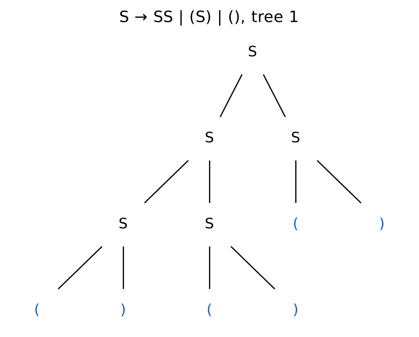
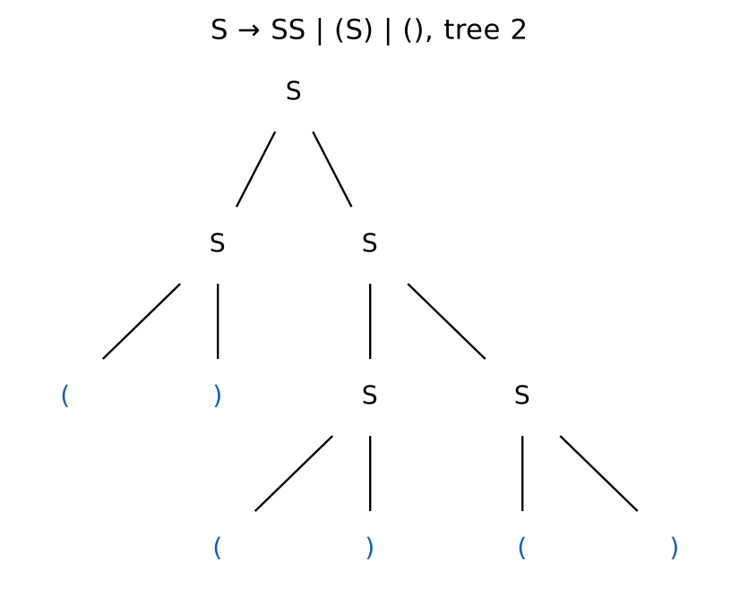
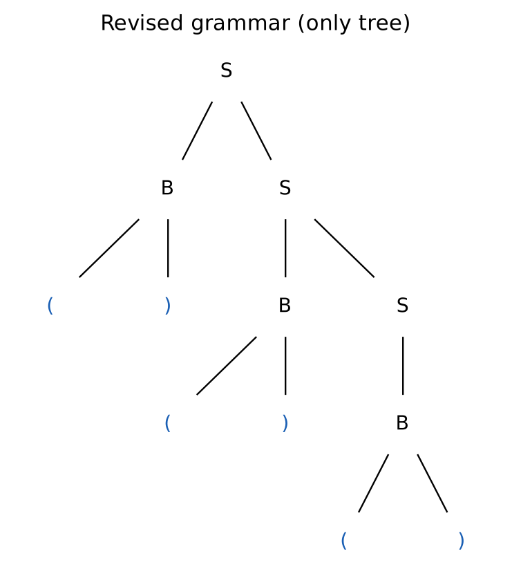
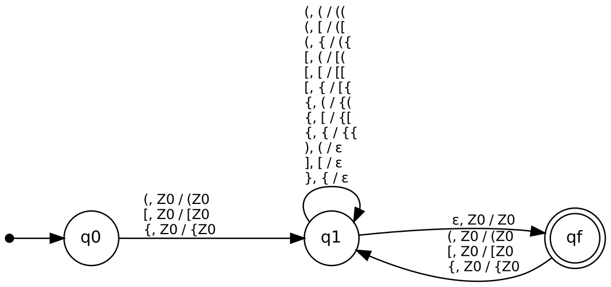
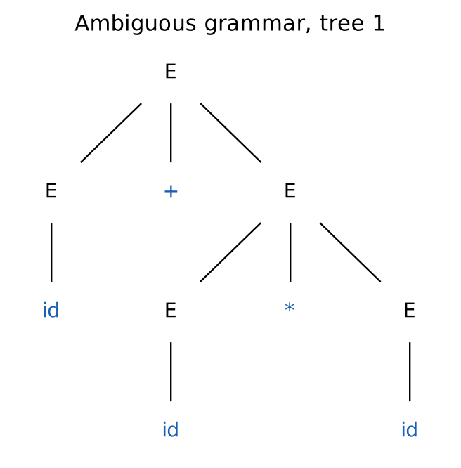
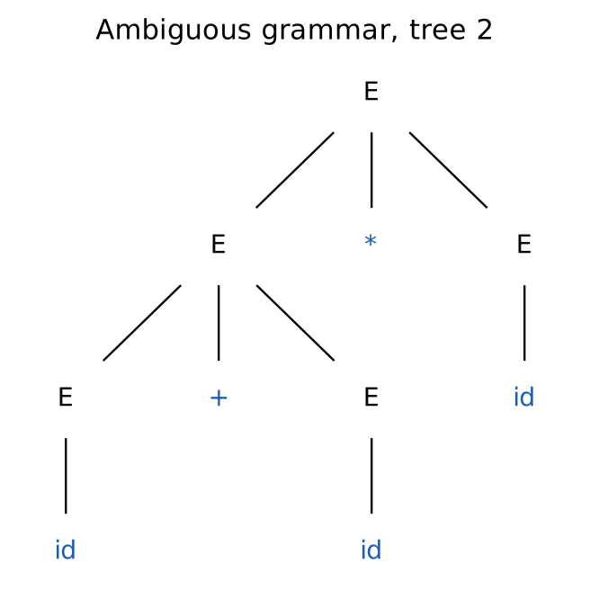
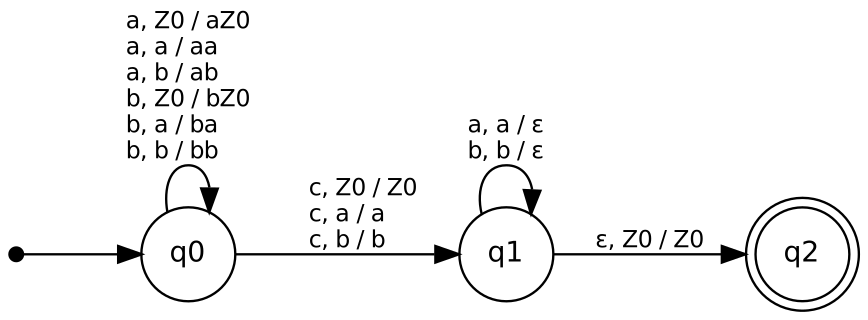

# Case Studies with Pushdown Automata and Context-Free Grammars

**Course:** 21CSC301T Formal Language and Automata, CLA-2, Assessment Task 3
**Student:** K R Vaishak (RA2411026050018), B.Tech AIML 'A', III year
**Faculty:** Dr. C. Gunasundari, SRM IST Tiruchirappalli

There are three case studies. Each one has a CFG, a PDA, derivations and stack moves,
accepted and rejected strings, and a discussion of ambiguity and determinism.

| # | Case study | Grammar | PDA | Deterministic? |
|---|---|---|---|---|
| 1 | Balanced brackets / code syntax checker | ambiguous `S → SS \| …`, fixed to `S → BS \| B` | 3-state DPDA | yes |
| 2 | Arithmetic expression validation | ambiguous `E → E+E \| E*E \| (E) \| id`, fixed by precedence, then LL(1) | CFG→PDA construction + predictive parser | general PDA no, LL(1) parser yes |
| 3 | Palindrome checker | `S → aSa \| bSb \| a \| b \| ε` | DPDA for `w c wᴿ`, NPDA for `w wᴿ` | `wcwᴿ` yes, `wwᴿ` no |

## Run it

```bash
python -m pda_cfg.cli all          # every case study, with derivations and stack moves
python -m pda_cfg.cli expr         # one case study at a time: brackets | expr | palindrome
python -m pda_cfg.cli ambiguity    # bounded ambiguity check of all six grammars
python -m pytest -q                # 34 tests
python tools/make_diagrams.py      # rebuild PDA diagrams and parse trees (needs Graphviz)
```

Pure Python 3, no dependencies except `pytest` for the tests.

## Why finite automata are not enough

Take L = { (ⁿ )ⁿ : n ≥ 1 } ⊂ balanced brackets. If L were regular with pumping
length p, the string s = (ᵖ)ᵖ splits as xyz with |xy| ≤ p and |y| ≥ 1. Then y
contains only `(`, so xy²z has more `(` than `)` and is not in L. That contradicts
the pumping lemma, so no DFA recognises balanced brackets. Intersecting with the
regular language (\*)\* shows the same for the full bracket language. The same
argument with aᵖbaᵖ works for palindromes. Arithmetic expressions contain
(ⁿ id )ⁿ, so they are not regular either. In every case the missing piece is an
unbounded counter or memory, and that is exactly what the PDA's stack gives.

## 1. Balanced brackets

Ambiguous grammar: `S → SS | (S) | [S] | {S} | () | [] | {}`

`()()()` has 2 parse trees and `()()()()` has 5 (a Catalan number), because `SS`
does not say how a list of blocks is grouped.

| tree 1 | tree 2 | revised grammar |
|---|---|---|
|  |  |  |

Revised grammar: `S → B S | B`, `B → (S) | () | [S] | [] | {S} | {}`. This builds the
list from the right, so every string has exactly one tree.

DPDA (accepts by final state):



An opening bracket is pushed. A closing bracket pops only if it matches the top.
When `Z0` is back on top, the ε-move goes to `qf`. In q1 there are no input moves
with `Z0` on top, so the ε-move never competes with an input move. That makes the
PDA deterministic.

**Syntax checker:** `bracket_tokens()` is a small lexer. It keeps only the brackets and skips string
literals, so `print("(not counted")` is still valid. Real compilers do the same:
a lexer feeds tokens to a deterministic pushdown parser.

## 2. Arithmetic expressions

`E → E+E | E*E | (E) | id` gives two leftmost derivations for `id+id*id`:

| tree 1: computes 2 + (3×4) = 14 | tree 2: computes (2+3)×4 = 20 |
|---|---|
|  |  |

Two trees give two different answers, so here the ambiguity is a real bug, not just a
technicality. The revised grammar puts `*` one level below `+`, so `*` binds tighter.
It is also left-recursive, so both operators associate to the left:

```
E → E + T | T        T → T * F | F        F → ( E ) | id
```

`pda_cfg/pda.py: cfg_to_pda()` turns this grammar into a one-state PDA that
accepts by empty stack. Its 3 choice points make it nondeterministic, and the
simulator searched 264 configurations to accept `id+id*id`. Removing left recursion
gives the LL(1) grammar. Its FIRST/FOLLOW table has no conflicts, so a
predictive parser handles it deterministically with one token of look-ahead. The
CLI prints every stack move.

## 3. Palindromes

* `S → aSa | bSb | a | b | ε` generates all palindromes and is unambiguous. The
  outermost pair is always fixed.
* `w c wᴿ`: the centre is marked, so the PDA pushes until `c` and then pops.
  This is a **DPDA**.
* `w wᴿ`: nothing marks the centre, so at every position the PDA must **guess**
  "this is the middle" with an ε-move. It is an NPDA, and no DPDA exists for this
  language, because even palindromes are not a deterministic CFL.

| DPDA `w c wᴿ` | NPDA `w wᴿ` |
|---|---|
|  |  |

## Layout

```
pda_cfg/grammar.py   CFG, leftmost/rightmost derivations, parse trees, ambiguity check
pda_cfg/pda.py       PDA simulator with IDs, determinism check, CFG→PDA construction
pda_cfg/ll1.py       FIRST/FOLLOW, LL(1) table, predictive parser
pda_cfg/cases.py     the three case studies and their test strings
pda_cfg/cli.py       terminal demo
tests/               pytest suite (exhaustive agreement with reference checkers)
docs/diagrams/       PDA diagrams and parse trees
```
